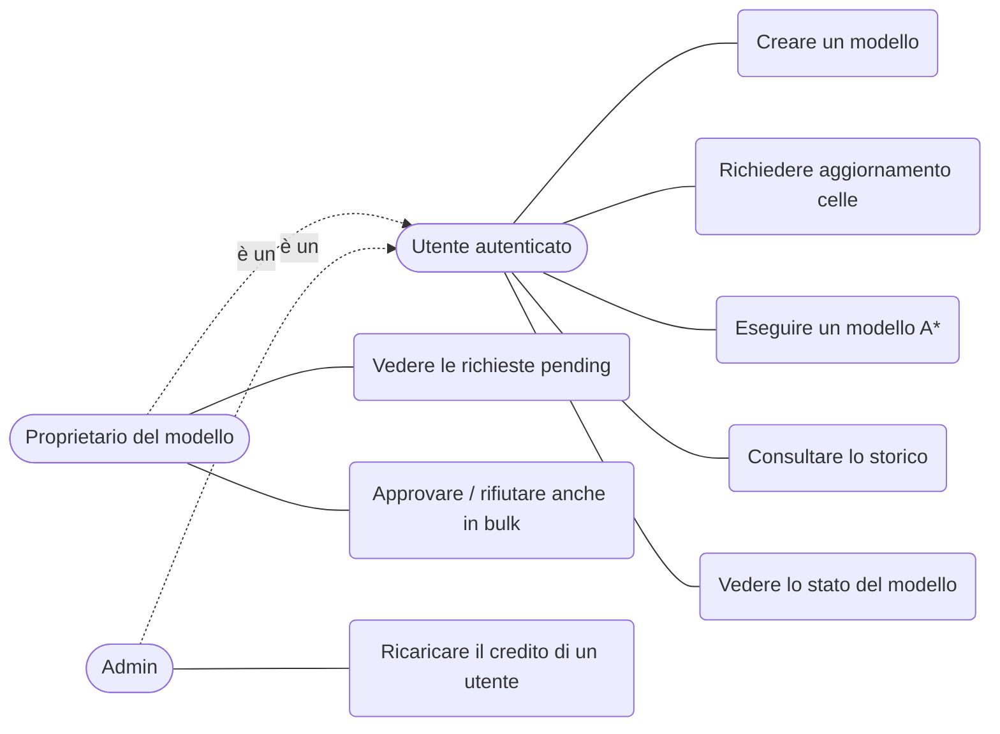
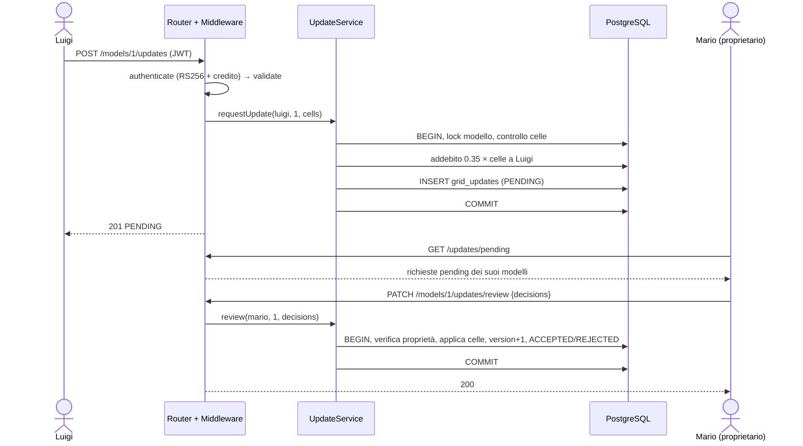
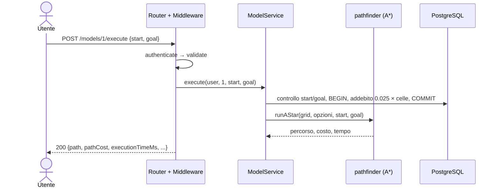
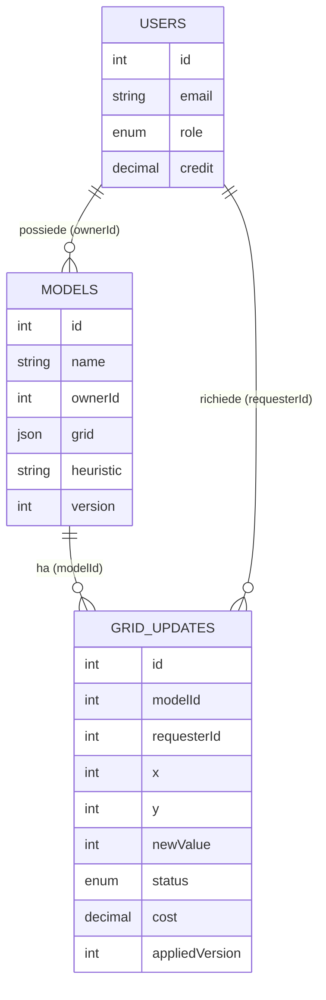

# Progetto Programmazione Avanzata A.A. 2025/2026 – Percorsi su griglia (A*) con crowd-sourcing

## 1. Obiettivo del progetto
Back-end REST scritto in **TypeScript** (Node.js + Express + Sequelize + PostgreSQL) che permette di creare e valutare
**modelli di ricerca del percorso su griglia** (matrice di 0 = libero e 1 = ostacolo) usando l'algoritmo A* della libreria
[`astar-typescript`](https://www.npmjs.com/package/astar-typescript).
Gli utenti autenticati con **JWT (RS256)** possono modificare la griglia (crowd-sourcing): se non sono i proprietari del modello,
la modifica deve essere approvata o rifiutata dal proprietario. Ogni operazione consuma **token** (credito) salvati nel database.

| Operazione | Costo in token |
|---|---|
| Creazione modello | 0.025 × numero di celle |
| Esecuzione modello | 0.025 × numero di celle |
| Richiesta di aggiornamento | 0.35 × celle da modificare (pagato da chi chiede) |

Codici di errore: `400` richiesta non valida, `401` token mancante/non valido/**token terminati**, `402` credito insufficiente,
`403` operazione non consentita, `404` risorsa non trovata.

## 2. Avvio con docker-compose
```bash
docker compose up --build
```
Parte PostgreSQL e l'API su `http://localhost:3000`. All'avvio il container esegue il **seed** (solo se il database è vuoto) e poi il server.
Il file `.env` contiene i parametri del DB e le **chiavi RSA (di sola demo)** per firmare/verificare i JWT. Per ripartire da zero: `docker compose down -v`.

Sviluppo locale (serve un PostgreSQL raggiungibile con i dati del `.env`):
```bash
npm install
npm run seed      # ricrea tabelle e dati di demo (--force)
npm run dev       # avvio del server
npm test          # test jest
```

### Dati di demo (seed)
| Utente | Ruolo | Token |
|---|---|---|
| admin@example.com (id 1) | admin | 1000 |
| mario@example.com (id 2) | user | 500 |
| luigi@example.com (id 3) | user | 300 |
| esaurito@example.com (id 4) | user | 0 (→ 401) |

3 modelli: *Strada Centro* (Mario, 5×5), *Magazzino* (Luigi, 6×4, diagonali), *Parco* (Mario, 4×4). Ognuno ha **almeno 2 versioni**
(la versione aumenta a ogni modifica applicata), più richieste accettate, rifiutate e una pending.

### JWT
`Authorization: Bearer <token>`, firma **RS256**; il back-end verifica con `JWT_PUBLIC_KEY` (nel `.env`).
Il payload contiene **solo** `sub` (id utente), `email`, `role`, `exp`. Il credito è nel DB, non nel token.
Per generare un token: `npm run token -- 2 mario@example.com user` (oppure jwt.io con la chiave privata del `.env`).

## 3. API
| Rotta | Descrizione |
|---|---|
| `POST /models` | Crea modello `{name, grid, heuristic?, diagonalAllowed?, includeStartNode?, includeEndNode?, weight?}` |
| `GET /models/:id/status` | Versione del modello e se ci sono richieste pending |
| `POST /models/:id/execute` | Esegue A*: `{start:{x,y}, goal:{x,y}}` → percorso, costo del percorso, tempo di esecuzione |
| `POST /models/:id/updates` | Richiede modifica celle `{cells:[{x,y,value}]}`: proprietario → applicata subito; altrimenti → PENDING |
| `GET /models/:id/updates?from=&to=&status=` | Storico diviso in `accepted` / `rejected`; `from` = successivi a, `to` = precedenti a, entrambi = intervallo |
| `GET /updates/pending` | Richieste pending sui modelli creati dall'utente autenticato |
| `PATCH /models/:id/updates/review` | Approva/rifiuta **una o più** richieste (bulk) `{decisions:[{updateId, approve}]}` – solo il proprietario |
| `PATCH /updates/:updateId` | Approva/rifiuta una singola richiesta `{approve}` – solo il proprietario |
| `POST /admin/recharge` | Solo admin: imposta il credito `{email, credit}` di un utente |

Coordinate: `x` = colonna, `y` = riga (`grid[y][x]`). Costo del percorso: 1 per passo ortogonale, √2 per passo diagonale.

### Scelte di interpretazione
- L'aggiornamento è addebitato subito a chi lo richiede (anche al proprietario); se viene rifiutato non c'è rimborso.
- Una cella si può richiedere solo se il valore cambia (0→1 o 1→0).
- `POST /admin/recharge` **imposta** il nuovo valore del credito.
- Un'approvazione bulk crea **una sola** nuova versione del modello.
- L'admin non è soggetto al blocco 401 per credito a zero (altrimenti non potrebbe ricaricare nessuno).
- Il filtro per data dello storico usa la data di creazione della richiesta.

## 4. Progettazione

> Documento di progettazione completo (architettura, diagramma delle classi, ER, stati, sei diagrammi di sequenza, pattern, sicurezza, transazioni, API): **[docs/PROGETTAZIONE.md](docs/PROGETTAZIONE.md)**.

### Diagramma dei casi d'uso


### Sequenza: aggiornamento richiesto da un non proprietario


### Sequenza: esecuzione di un modello


### Modello dati


### Struttura delle cartelle
```
src/config        variabili d'ambiente e connessione al DB (Singleton)
src/models        tabelle Sequelize
src/repositories  query al database (Repository)
src/services      logica di business, transazioni, addebiti
src/controllers   gestori sottili delle rotte
src/middleware    autenticazione JWT, validazione, gestione errori
src/errors        AppError + ErrorFactory (Factory)
src/utils         algoritmo A* (funzioni pure)
src/seeders       seed di demo
scripts           generazione token e collection Postman
tests             test jest
postman           collection + environment
```

### Design pattern usati e motivazione
- **Singleton** (`config/database.ts`): una sola istanza Sequelize/pool di connessioni in tutta l'app; evita connessioni multiple.
- **Factory** (`errors/AppError.ts`, `ErrorFactory`): crea in un punto solo gli errori HTTP; i service lanciano eccezioni senza conoscere i codici di stato.
- **Repository** (`src/repositories`): isola le query; i service non usano Sequelize direttamente e il codice è più testabile.
- **Chain of Responsibility** (middleware Express): ogni rotta passa per `authenticate → isAdmin → validate → controller → errorHandler`; ogni anello fa una cosa e può interrompere la catena con un errore.
- **Layered architecture** (routes → controllers → services → repositories → models): separa HTTP, logica e persistenza.

Addebiti e aggiornamenti usano **transazioni** con lock di riga (`SELECT … FOR UPDATE`) per evitare doppie spese o modifiche concorrenti incoerenti.
Gli errori sono gestiti dai middleware (`error.middleware.ts`).

## 5. Test
**Jest** (`npm test`, 11 test): A* (percorso, nessun percorso, costo diagonale), validazione della griglia e delle richieste,
middleware di autenticazione (401 senza token, chiave sbagliata, token terminati; 403 non admin).

**Postman / Newman**: `postman/collection.json` (37 richieste con test, 7 cartelle) + `postman/environment.json`
(variabile **`baseUrl`**, JWT dei 4 utenti, id salvati automaticamente). Da eseguire in ordine su un DB appena creato:
```bash
docker compose down -v && docker compose up --build -d
npx newman run postman/collection.json -e postman/environment.json
```
In Postman: *Import* di **entrambi** i file → in alto a destra selezionare l'environment **Pathfinding local** → *Run collection*.
Le richieste usano `{{baseUrl}}` (con la U maiuscola) e i token `{{tokenMario}}`, `{{tokenLuigi}}`, `{{tokenAdmin}}`, `{{tokenEsaurito}}`.
Per rigenerare i file: `npm run postman`.
