# Progettazione del sistema

Documento di progettazione del back-end *Pathfinding crowd-sourcing* (Programmazione Avanzata A.A. 2025/2026).
I diagrammi sono scritti in [Mermaid](https://mermaid.js.org/) e vengono disegnati direttamente da GitHub.

## Indice
1. [Requisiti e tracciabilità](#1-requisiti-e-tracciabilità)
2. [Architettura generale](#2-architettura-generale)
3. [Diagramma dei casi d'uso](#3-diagramma-dei-casi-duso)
4. [Diagramma delle classi](#4-diagramma-delle-classi)
5. [Modello dei dati](#5-modello-dei-dati)
6. [Ciclo di vita di una richiesta di aggiornamento](#6-ciclo-di-vita-di-una-richiesta-di-aggiornamento)
7. [Diagrammi di sequenza](#7-diagrammi-di-sequenza)
8. [Catena dei middleware](#8-catena-dei-middleware)
9. [Design pattern](#9-design-pattern)
10. [Sicurezza e JWT](#10-sicurezza-e-jwt)
11. [Transazioni e concorrenza](#11-transazioni-e-concorrenza)
12. [Validazione e gestione degli errori](#12-validazione-e-gestione-degli-errori)
13. [Specifica delle API](#13-specifica-delle-api)
14. [Scelte di interpretazione della traccia](#14-scelte-di-interpretazione-della-traccia)
15. [Strategia di test](#15-strategia-di-test)
16. [Possibili miglioramenti](#16-possibili-miglioramenti)

---

## 1. Requisiti e tracciabilità

Il sistema gestisce **modelli di ricerca del percorso su griglia** (matrice di 0 = libero, 1 = ostacolo). Gli utenti autenticati possono
contribuire modificando le celle (crowd-sourcing). Ogni azione costa **token**, memorizzati nel database.

| # | Requisito della traccia | Rotta | Implementazione |
|---|---|---|---|
| R1 | Creare un modello con griglia iniziale, con validazione | `POST /models` | `validateCreateModel`, `ModelService.createModel` |
| R2 | Costo creazione = 0.025 × celle; serve credito sufficiente | `POST /models` | `CreditService.charge` (errore 402) |
| R3 | Aggiornare celle: se l'utente è il proprietario, modifica diretta | `POST /models/:id/updates` | `UpdateService.requestUpdate` |
| R4 | Se l'utente NON è il proprietario, la richiesta va approvata/rifiutata | `PATCH /updates/:updateId` | `UpdateService.reviewSingle` |
| R5 | Costo aggiornamento = 0.35 × celle, pagato da chi richiede | `POST /models/:id/updates` | `CreditService.charge` |
| R6 | Storico aggiornamenti con filtro data (da / a / intervallo) e stato | `GET /models/:id/updates` | `UpdateRepository.findHistory` |
| R7 | Stato del modello (richieste pending) | `GET /models/:id/status` | `ModelService.getStatus` |
| R8 | Richieste pending sui modelli creati dall'utente | `GET /updates/pending` | `UpdateRepository.findPendingForOwner` |
| R9 | Approvare/rifiutare una o più celle (bulk), solo il proprietario | `PATCH /models/:id/updates/review` | `UpdateService.review` |
| R10 | Eseguire il modello (start, goal) con costo, percorso, costo del percorso e tempo | `POST /models/:id/execute` | `ModelService.execute`, `utils/pathfinder.ts` |
| R11 | JWT RS256 con soli metadati; token terminati → 401 | tutte | `authenticate` |
| R12 | Rotta admin per la ricarica (email + nuovo credito) | `POST /admin/recharge` | `isAdmin`, `AdminService.recharge` |
| R13 | Credito salvato nel DB, seed con almeno 3 modelli e 2 versioni | – | `User.credit`, `seeders/seed.ts` |
| R14 | Middleware e gestione errori con eccezioni | tutte | `error.middleware.ts`, `ErrorFactory` |
| R15 | Chiavi nel `.env`, docker-compose, test Jest, collection Postman | – | `.env`, `docker-compose.yml`, `tests/`, `postman/` |

Requisiti non funzionali: TypeScript, Node.js + Express, Sequelize con PostgreSQL, codice commentato, design pattern documentati.

---

## 2. Architettura generale

L'applicazione è organizzata a **strati** (layered architecture). Ogni strato conosce solo quello immediatamente sotto di sé.

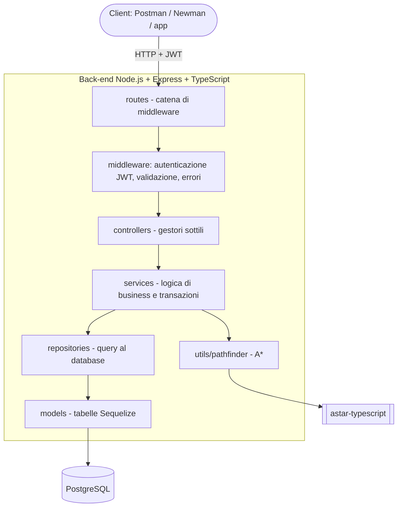

| Strato | Cartella | Responsabilità |
|---|---|---|
| Routing | `src/routes` | Associa ogni rotta alla sua catena di middleware e al controller |
| Middleware | `src/middleware` | Autenticazione, autorizzazione, validazione, gestione errori |
| Controller | `src/controllers` | Legge `req`, chiama il service, scrive `res` (nessuna logica) |
| Service | `src/services` | Regole di business: costi, proprietà, versioni, transazioni |
| Repository | `src/repositories` | Unico punto in cui si scrivono query Sequelize |
| Model | `src/models` | Definizione delle tabelle e delle relazioni |
| Utility | `src/utils` | Algoritmo A* come funzione pura (testabile senza database) |
| Config | `src/config` | Variabili d'ambiente, connessione al DB (Singleton) |

**Perché questa scelta.** Separare gli strati permette di testare la logica senza server né database (es. il test di `pathfinder` e quello del
middleware con repository finto) e di cambiare una parte (per esempio il DB) toccando un solo strato.

---

## 3. Diagramma dei casi d'uso

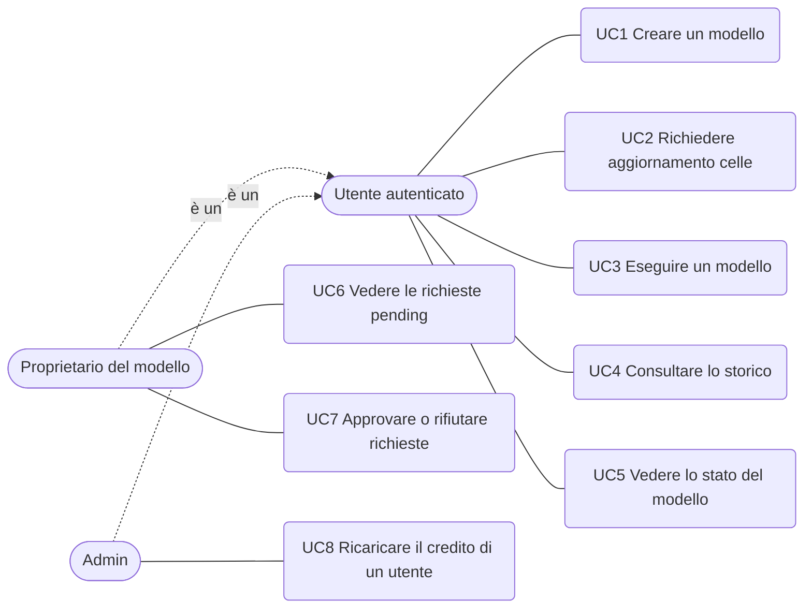

Il *proprietario* non è un utente a parte: è l'utente che ha creato **quel** modello. Il ruolo `admin` è invece un attributo dell'utente.

| Caso d'uso | Attore | Precondizioni | Flusso principale | Alternative / errori |
|---|---|---|---|---|
| UC1 Creare modello | Utente | JWT valido, credito ≥ costo | Invia nome e griglia → validazione → addebito → modello creato (versione 1) | 400 griglia non valida · 402 credito insufficiente |
| UC2 Richiedere aggiornamento | Utente | Modello esistente, credito ≥ 0.35 × celle | Invia le celle → controlli → addebito → se proprietario applica subito (versione +1), altrimenti PENDING | 400 cella fuori griglia o valore invariato · 402 · 404 |
| UC3 Eseguire modello | Utente | Start e goal liberi e dentro la griglia | Addebito → A* → percorso, costo del percorso, tempo | 400 start/goal non validi · 402 · 404 |
| UC4 Storico | Utente | – | Legge gli aggiornamenti ACCEPTED/REJECTED, filtrabili per data e stato | 400 data non valida |
| UC5 Stato modello | Utente | – | Restituisce versione e numero di richieste pending | 404 |
| UC6 Richieste pending | Proprietario | – | Elenca le richieste PENDING sui propri modelli | – |
| UC7 Approvare/rifiutare | Proprietario | Richieste in stato PENDING | Per ogni richiesta decide; le approvate modificano la griglia e creano una nuova versione | 403 non proprietario · 400 già gestita · 404 |
| UC8 Ricaricare credito | Admin | Ruolo admin | Imposta il nuovo credito dell'utente indicato per email | 403 non admin · 404 email sconosciuta |

---

## 4. Diagramma delle classi

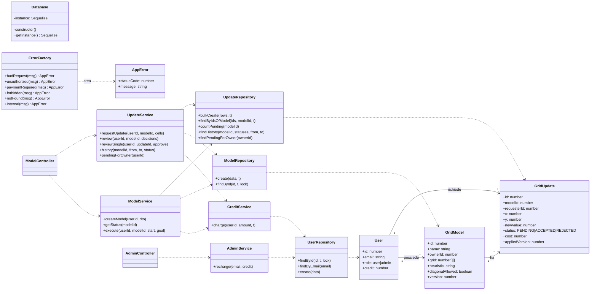

---

## 5. Modello dei dati

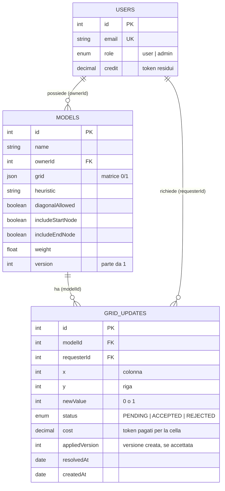

Motivazioni principali:

- **Una riga per cella** in `GRID_UPDATES`: permette di approvare o rifiutare cella per cella (anche in bulk) e di costruire lo storico per cella.
- **`version` in `MODELS`** cresce di 1 a ogni modifica applicata; **`appliedVersion`** lega ogni aggiornamento accettato alla versione che ha prodotto.
- **`grid` come JSON**: la matrice è sempre letta e scritta per intero (A* la usa tutta), quindi non conviene normalizzarla in una tabella di celle.
- **`credit` come DECIMAL(12,3)**: evita gli errori di arrotondamento dei numeri in virgola mobile (costi come 0.025 e 0.35). Sequelize lo restituisce come stringa, quindi un *getter* lo converte in numero.
- Il **credito nel DB e non nel JWT**: il token resta fisso e piccolo, mentre il credito cambia a ogni operazione.

---

## 6. Ciclo di vita di una richiesta di aggiornamento

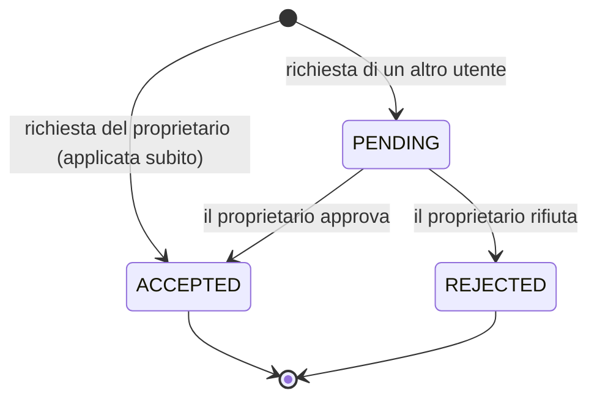

Solo lo stato `PENDING` può cambiare. Una richiesta già gestita non può essere decisa di nuovo (errore 400).

---

## 7. Diagrammi di sequenza

### 7.1 Autenticazione (middleware `authenticate`)
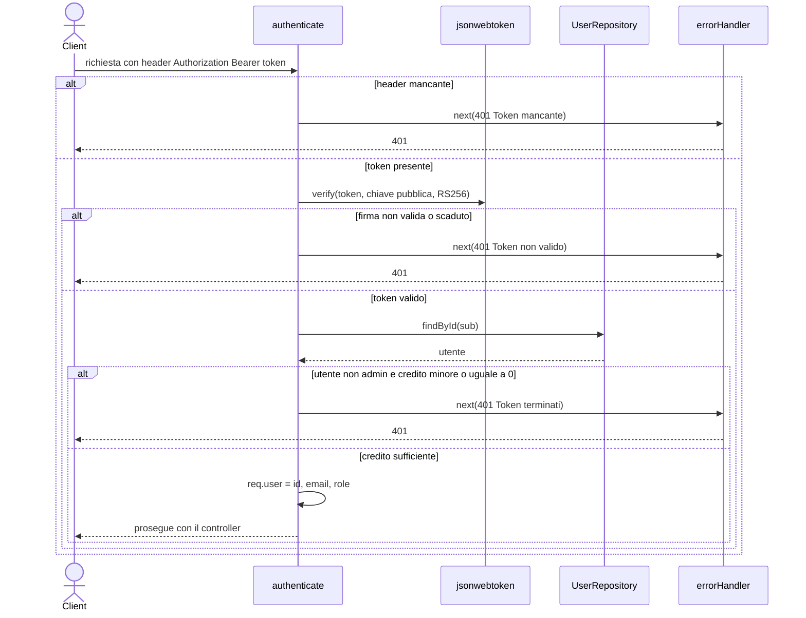

### 7.2 Creazione di un modello
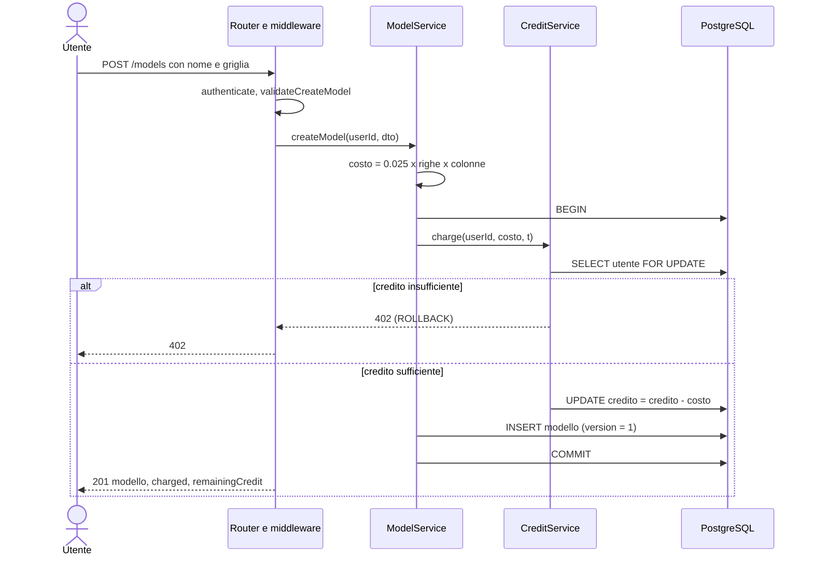

### 7.3 Richiesta di aggiornamento (proprietario e non proprietario)
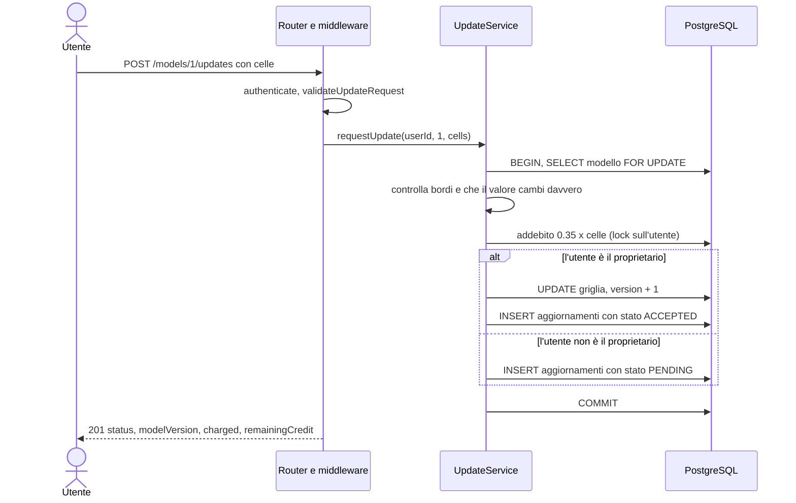

### 7.4 Approvazione / rifiuto in bulk
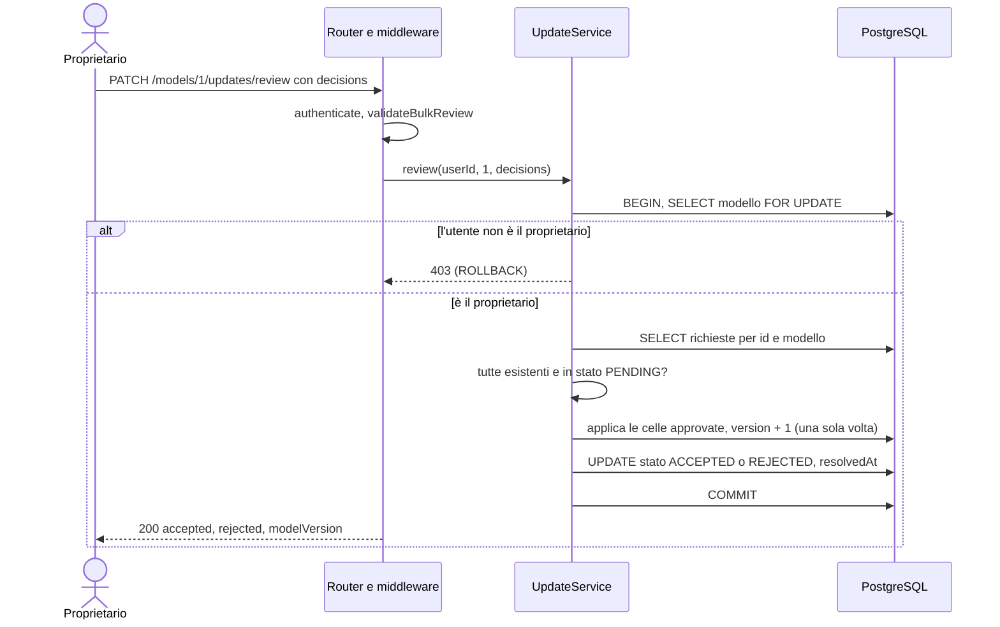

### 7.5 Esecuzione di un modello
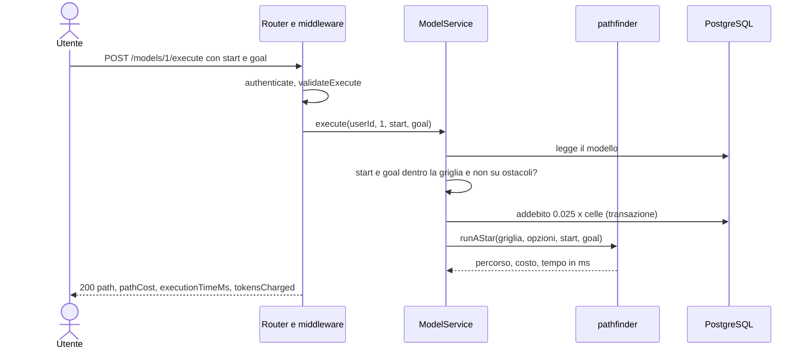

### 7.6 Ricarica del credito (admin)
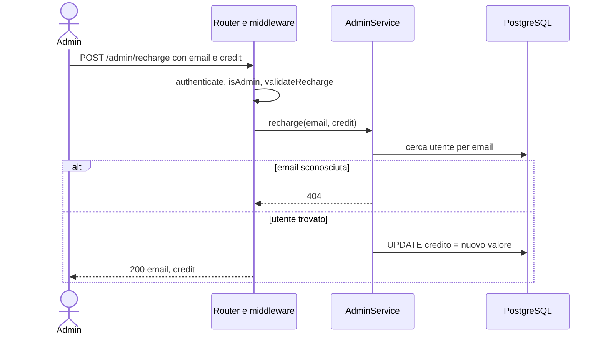

---

## 8. Catena dei middleware

Ogni richiesta attraversa una catena in cui ogni anello fa una sola cosa e può interromperla passando un errore a `next(err)`.

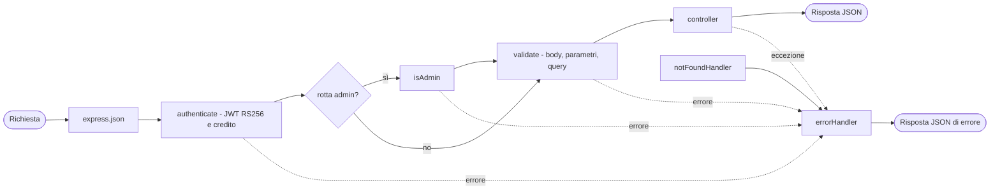

Ordine in `routes/index.ts`: `authenticate` si applica a **tutte** le rotte (`router.use`). Le rotte con segmento fisso (`/updates/pending`) sono dichiarate
prima di quelle con parametro (`/updates/:updateId`), altrimenti Express interpreterebbe `pending` come un id.

---

## 9. Design pattern

| Pattern | Dove | Problema risolto | Alternativa scartata |
|---|---|---|---|
| **Singleton** | `config/database.ts` | Una sola connessione/pool Sequelize in tutta l'app | Creare un `new Sequelize` in ogni file: molte connessioni, stato incoerente |
| **Factory** | `errors/AppError.ts` (`ErrorFactory`) | Creare errori HTTP uniformi senza ripetere codici di stato nel codice | `throw new AppError(404, ...)` sparso ovunque |
| **Repository** | `src/repositories` | Isolare le query: i service non conoscono Sequelize | Query Sequelize dentro i service: difficile da testare e da cambiare |
| **Chain of Responsibility** | middleware Express | Ogni controllo (auth, ruolo, validazione, errori) è un anello indipendente | Un unico controller con tutti i controlli in sequenza |
| **Layered architecture** | tutto il progetto | Separare HTTP, logica e persistenza | Logica dentro le rotte |

Dettaglio dei pattern:

**Singleton.** Il costruttore è `private`; `Database.getInstance()` crea l'oggetto alla prima chiamata e poi restituisce sempre lo stesso.
I modelli Sequelize (`User`, `GridModel`, `GridUpdate`) usano tutti la stessa istanza.

**Factory.** `ErrorFactory.notFound('...')` restituisce un `AppError` con `statusCode = 404`. Il middleware degli errori legge `statusCode`.
Chi lancia l'errore dice *cosa* è successo, non *come* si risponde.

**Repository.** `UpdateRepository.findHistory` costruisce il filtro per data (`Op.between`, `Op.gte`, `Op.lte`). Il service chiede soltanto «lo storico
con questi filtri». Nei test il repository viene sostituito con un oggetto finto.

**Chain of Responsibility.** Esempio della rotta `POST /models/:id/updates`: `authenticate → validateIdParam → validateUpdateRequest → controller`.
Se un anello fallisce chiama `next(errore)` e la catena si interrompe, passando al `errorHandler`.

---

## 10. Sicurezza e JWT

- **Algoritmo RS256** (asimmetrico): il token è firmato con la **chiave privata** (usata per generare i token di prova) e verificato dal back-end con la **chiave pubblica**.
  Chi conosce solo la chiave pubblica può verificare ma non può creare token.
- Le chiavi sono nel file **`.env`** (`JWT_PRIVATE_KEY`, `JWT_PUBLIC_KEY`), su una riga con i `\n`. Le chiavi del repository sono **di sola demo**.
- `jwt.verify(..., { algorithms: ['RS256'] })` accetta **solo** RS256: impedisce attacchi in cui il token dichiara un altro algoritmo (per esempio `none`).
- **Payload minimo**: `sub` (id utente), `email`, `role`, `exp`. Nessun dato della richiesta e nessun credito nel token.
- **Token terminati**: dopo la verifica della firma, il middleware legge l'utente dal DB; se non è admin e il credito è ≤ 0 risponde **401**.
  L'admin è escluso, altrimenti non potrebbe ricaricare nessuno.
- **Autorizzazione**: `isAdmin` controlla il ruolo (403); la proprietà del modello è verificata nel service (403).
- Gli errori imprevisti rispondono **500 generico**: i dettagli interni non arrivano al client.

---

## 11. Transazioni e concorrenza

Il credito è una risorsa condivisa: due richieste contemporanee dello stesso utente non devono spendere gli stessi token.

1. Ogni operazione che costa token è eseguita in **una transazione** (`sequelize.transaction`): se qualcosa fallisce dopo l'addebito, c'è il rollback e l'utente non perde token.
2. La riga dell'utente è letta con **`SELECT ... FOR UPDATE`** (`lock`): una seconda richiesta attende la fine della prima e poi legge il credito aggiornato.
3. Anche la riga del **modello** è bloccata durante aggiornamento e revisione: due revisioni simultanee non possono applicare modifiche incoerenti né creare due versioni con lo stesso numero.
4. Il **bulk è atomico**: se una decisione non è valida (richiesta inesistente o già gestita), non viene applicata nessuna decisione.
5. I costi sono arrotondati a 3 decimali (`round3`) per evitare errori come `0.1 + 0.2`.

---

## 12. Validazione e gestione degli errori

La validazione è un middleware (strato **prima** del controller) e produce sempre un `400` con un messaggio chiaro.

| Controllo | Dove |
|---|---|
| `id` e `updateId` interi positivi | `validateIdParam` |
| Griglia non vuota, rettangolare, al massimo 100×100, solo valori 0/1 | `checkGrid`, `validateCreateModel` |
| `heuristic` in {Manhattan, Euclidean, Chebyshev, Octile}, booleani, `weight` > 0 | `validateCreateModel` |
| Celle con `x`, `y` interi ≥ 0, `value` 0/1, senza duplicati | `validateUpdateRequest` |
| `start` e `goal` come `{x, y}` interi | `validateExecute` |
| Decisioni con `updateId` e `approve`, senza duplicati | `validateBulkReview`, `validateSingleReview` |
| Date ISO valide, `from` ≤ `to`, `status` ∈ {ACCEPTED, REJECTED} | `validateHistoryQuery` |
| Email valida e credito ≥ 0 | `validateRecharge` |

Le regole che dipendono dai dati (cella fuori griglia, valore invariato, start su un ostacolo) sono controllate nei **service**, che hanno accesso al modello.

| Codice | Significato | Esempi |
|---|---|---|
| 400 | Richiesta non valida | griglia errata, cella uguale al valore richiesto, richiesta già gestita, JSON malformato |
| 401 | Non autenticato | token mancante, non valido, **credito terminato** |
| 402 | Credito insufficiente | token non bastano per quella specifica operazione |
| 403 | Non consentito | non admin sulla rotta admin, non proprietario che approva |
| 404 | Non trovato | modello, richiesta o utente inesistente, rotta sconosciuta |
| 500 | Errore interno | errore imprevisto (messaggio generico) |

Gli errori **non** sono gestiti con `try/catch` nei controller: i service lanciano `ErrorFactory.xxx()`, Express 5 inoltra le eccezioni (anche nelle funzioni `async`)
al middleware `errorHandler`, che risponde `{ "error": "messaggio" }`.

---

## 13. Specifica delle API

Tutte le rotte richiedono `Authorization: Bearer <JWT>`. Coordinate: `x` = colonna, `y` = riga (`grid[y][x]`).

### `POST /models`
```json
{ "name": "Strada Centro", "grid": [[0,0,0],[0,1,0],[0,0,0]], "diagonalAllowed": false, "heuristic": "Manhattan" }
```
`201`: `{ "model": { "id": 4, "version": 1, ... }, "charged": 0.225, "remainingCredit": 499.775 }`

### `GET /models/:id/status`
`200`: `{ "modelId": 1, "name": "Strada Centro", "version": 2, "hasPendingRequests": true, "pendingRequests": 1 }`

### `POST /models/:id/execute`
```json
{ "start": { "x": 0, "y": 0 }, "goal": { "x": 4, "y": 4 } }
```
`200`: `{ "found": true, "path": [[0,0],[1,0],...], "pathCost": 8, "executionTimeMs": 1.9, "tokensCharged": 0.625, "remainingCredit": 497.65 }`
Se non esiste un percorso: `found: false` e `path: []`. I token sono comunque addebitati.

### `POST /models/:id/updates`
```json
{ "cells": [ { "x": 1, "y": 1, "value": 0 }, { "x": 4, "y": 3, "value": 1 } ] }
```
`201`: `{ "status": "ACCEPTED" | "PENDING", "appliedImmediately": true, "modelVersion": 3, "charged": 0.7, "remainingCredit": 480.1, "updates": [...] }`

### `GET /models/:id/updates?from=&to=&status=`
- `from` = aggiornamenti **dalla** data in poi; `to` = **fino alla** data; entrambi = intervallo; `status` = `ACCEPTED` oppure `REJECTED` (facoltativo).
- Date in formato ISO, per esempio `2026-01-01` o `2026-01-01T10:00:00Z`.

`200`: `{ "modelId": 1, "accepted": [ ... ], "rejected": [ ... ] }`

### `GET /updates/pending`
`200`: lista delle richieste `PENDING` sui modelli creati dall'utente autenticato (ognuna con `model: { id, name }`).

### `PATCH /models/:id/updates/review` (bulk)
```json
{ "decisions": [ { "updateId": 2, "approve": true }, { "updateId": 7, "approve": false } ] }
```
`200`: `{ "modelId": 1, "modelVersion": 3, "accepted": 1, "rejected": 1, "updates": [...] }`

### `PATCH /updates/:updateId` (singola)
```json
{ "approve": true }
```

### `POST /admin/recharge`
```json
{ "email": "esaurito@example.com", "credit": 10 }
```
`200`: `{ "email": "esaurito@example.com", "credit": 10 }`

---

## 14. Scelte di interpretazione della traccia

| Punto ambiguo | Scelta | Motivo |
|---|---|---|
| Chi paga l'aggiornamento? | Chi richiede, anche se è il proprietario | La traccia dice «sottratto all'utente che sta facendo la richiesta» |
| Rimborso se la richiesta è rifiutata | Nessun rimborso | La traccia non lo prevede; scoraggia richieste inutili |
| «Nuovo credito» nella ricarica | Il valore **sostituisce** il credito attuale | Letteralmente «nuovo credito» |
| Modifica che non cambia il valore | Rifiutata con 400 | La traccia parla di cambiare da 0 a 1 o da 1 a 0 |
| Cosa fa salire la versione | Ogni applicazione di modifiche; un bulk crea **una** sola versione | Una revisione è un unico evento |
| Costo del percorso | 1 per passo ortogonale, √2 per passo diagonale | Pesi di un grafo a griglia; con diagonali spente vale il numero di passi |
| Data del filtro «data di modifica» | Data di creazione della richiesta (`createdAt`) | È il momento in cui la modifica è proposta |
| Admin con credito 0 | Non subisce il 401 | Altrimenti non potrebbe fare la ricarica |
| Nessun percorso trovato | `200` con `found: false`, token addebitati | Il calcolo è stato eseguito |

---

## 15. Strategia di test

| Livello | Strumento | Cosa verifica |
|---|---|---|
| Unitari | Jest + ts-jest | A* (percorso, nessun percorso, costo diagonale), validazione della griglia e delle celle duplicate, middleware di autenticazione (401 senza token, chiave sbagliata, token terminati; 403 non admin) |
| Integrazione / end-to-end | Postman + Newman | 37 richieste con 53 asserzioni su tutte le rotte: casi validi, errori 400/401/402/403/404, flusso pending → approvazione, bulk, storico con filtri, ricarica admin |

Nei test di autenticazione il repository degli utenti è sostituito con un oggetto finto (`jest.mock`) e le chiavi RSA sono generate in `tests/setup.ts`,
quindi non servono database né `.env`. I test Postman partono da un database appena seedato (`docker compose down -v`).

---

## 16. Possibili miglioramenti

- Salvare uno **snapshot** della griglia per ogni versione, per poter eseguire il modello su una versione precedente.
- Rimborsare il richiedente quando una richiesta è rifiutata.
- Aggiungere paginazione allo storico e alle richieste pending.
- Aggiungere una rotta di login che emetta i JWT (la traccia prevede token generati esternamente, per esempio con jwt.io).
- Test di integrazione automatici con `supertest` e un database di prova.
